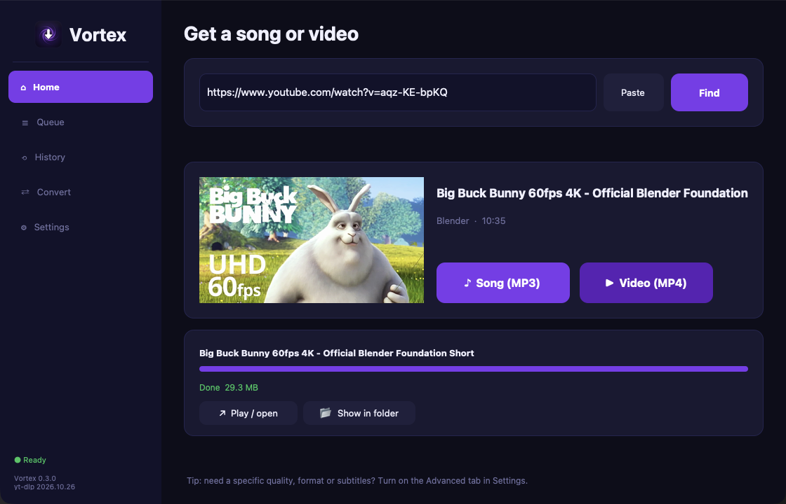
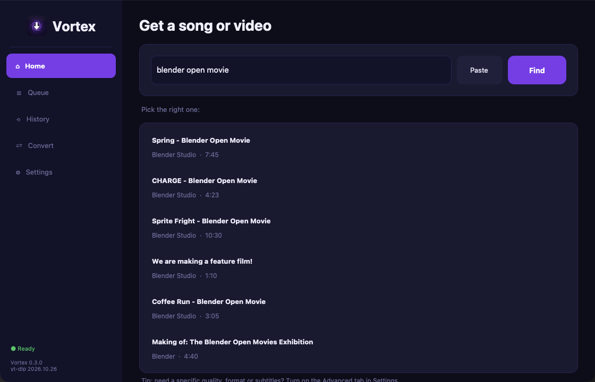
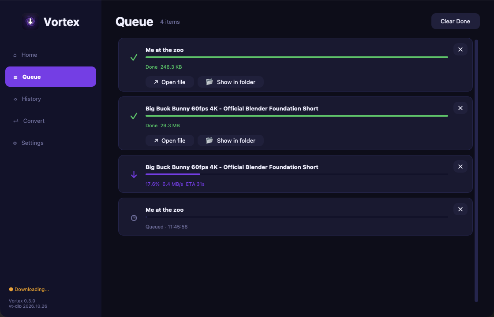
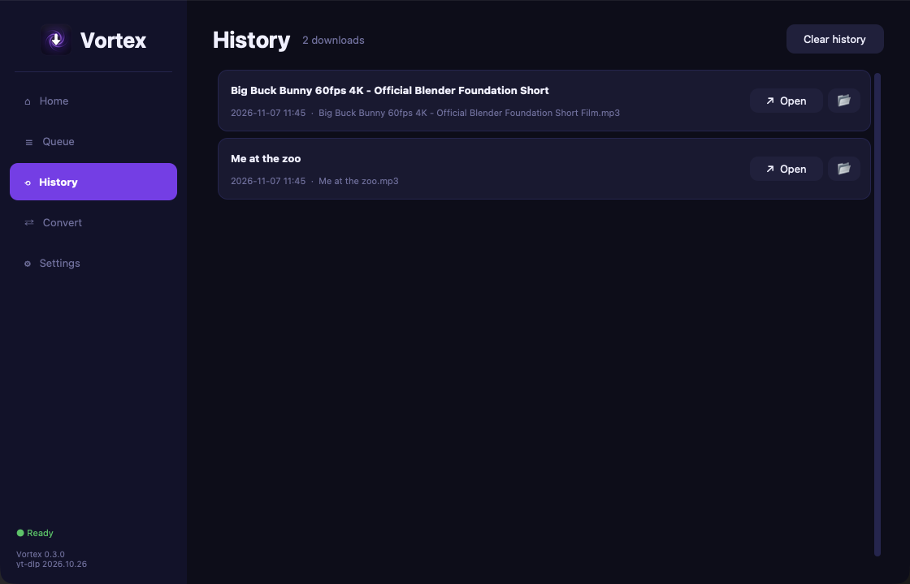
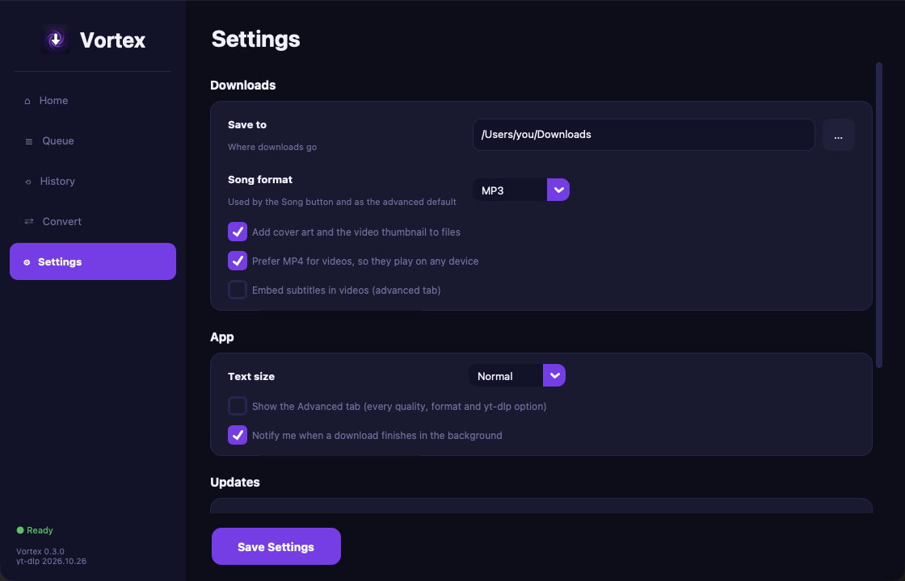

# Vortex

A simple desktop app for downloading music and video from YouTube and other
sites, built on [yt-dlp](https://github.com/yt-dlp/yt-dlp) and
[FFmpeg](https://ffmpeg.org).

I made it for my mom and my brother. They used to download songs from shady
converter websites full of ads and malware, and the command line tools were too
technical for them. Vortex wraps those same tools in a window with one search
box and two buttons, and ships FFmpeg inside the app so there's nothing else to
install.

Runs on Windows and macOS.



## Download

Get the latest version from the
[Releases page](https://github.com/FarAbove420/vortex/releases):

- **Windows**: `Vortex-Setup.exe`
- **macOS**: `Vortex-macOS.zip`, unzip it and drag Vortex to Applications

The builds are not code-signed, so Windows SmartScreen and macOS Gatekeeper
warn the first time you open Vortex.

## What it does

**Home** is the simple way in:

- Paste a link, or type a song name and pick from the search results
- Copy a link anywhere and switch to Vortex: it's filled in and looked up
- A preview shows the thumbnail, title, channel and length
- Two big buttons: **Song** (MP3 with cover art and tags) and **Video** (MP4
  that plays on any device)

The rest:

- **Queue**: several downloads in a row, progress ("song 3 of 37" for
  playlists), cancel, open the file or show it in its folder, and "Retry with
  browser cookies" when YouTube asks to confirm you're not a bot
- **History**: everything downloaded before, also after a restart
- **Settings**: download folder, song format, text size, notifications and
  updates
- **Convert**: change local files to another format, change codecs and trim
- **Advanced** (switch it on in Settings, a tip on Home points there): every
  quality and format option, subtitles, SponsorBlock and extra yt-dlp flags

| Search by song name | The queue |
|---|---|
|  |  |
| **History** | **Settings** |
|  |  |

Vortex never overwrites a file: a second song with the same name is saved as
"Title (2)". It warns before quitting with unfinished downloads, and only one
Vortex runs at a time.

## Automatic updates

YouTube changes often, and older yt-dlp versions stop working. Since yt-dlp
2025.11.12, YouTube downloads also need a JavaScript runtime such as Deno
([yt-dlp announcement](https://github.com/yt-dlp/yt-dlp/issues/15012)).
Vortex takes care of both, so nobody has to reinstall the app when YouTube
breaks something:

- **yt-dlp**: at most every 6 hours, Vortex looks for a newer
  [yt-dlp release](https://github.com/yt-dlp/yt-dlp/releases). It's downloaded
  to `~/.vortex/yt-dlp/`, checked against the release's `SHA2-256SUMS`, and
  used from the next start. The previous download is kept.
- **Deno**: downloaded to `~/.vortex/bin/`, checked against its `.sha256sum`
  file, and refreshed once a week.
- **Vortex itself**: once a day it checks for a new release and shows a
  clickable note in the sidebar.
- **If an update is bad**: a downloaded yt-dlp that doesn't load, or fails
  with a missing module, is dropped automatically and Vortex goes back to the
  previous one or the built-in copy. Settings also has "Undo the last yt-dlp
  update" and "Always use the yt-dlp built into the app".

Versions are read from where `github.com/<project>/releases/latest` redirects
to, so the GitHub API's limit of 60 requests per hour doesn't apply. The
checksums protect against broken downloads; like `yt-dlp -U`, Vortex doesn't
check signatures.

This means Vortex contacts `github.com` when it starts. You can turn it off in
Settings with "Keep yt-dlp and Deno up to date".

## Running from source

You need Python 3.10 or newer.

```bash
git clone https://github.com/FarAbove420/vortex.git
cd vortex
python3 -m venv .venv
source .venv/bin/activate        # Windows: .venv\Scripts\activate
pip install -r requirements.txt
python main.py
```

### Tests

```bash
pip install -r requirements-dev.txt
python -m pytest                 # fast, offline
python -m pytest --network       # also real downloads from YouTube and GitHub
```

Tests use a temporary home folder, so they never touch your own `~/.vortex`.

### Code layout

| Path | What's in it |
|---|---|
| `main.py` | Starts the app |
| `vortex/config.py` | Paths, logging, settings |
| `vortex/ytdl.py` | The one place yt-dlp is imported |
| `vortex/media.py` | Download options, downloading, preview, search, thumbnails |
| `vortex/updater.py` | yt-dlp, Deno and Vortex updates |
| `vortex/history.py` | Download history |
| `vortex/system.py` | Opening files, notifications, single instance |
| `vortex/ui/` | The window and one file per tab |

## Building the app

GitHub Actions builds both versions: push a tag like `v0.3.0` and
`.github/workflows/release.yml` builds Windows and macOS and publishes a
release with the notes from [CHANGELOG.md](CHANGELOG.md). "Run workflow" on the
Actions tab builds without publishing.

To build yourself:

- **Windows**: see [WINDOWS_BUILD.md](WINDOWS_BUILD.md). It produces
  `Vortex.exe` and a `Vortex-Setup.exe` installer.
- **macOS**: needs a universal2 Python from python.org. Fetch the Intel FFmpeg
  binary once, then build:

  ```bash
  pip install -r requirements-build.txt
  ./vendor/fetch-x86_64-ffmpeg.sh
  pyinstaller Vortex.spec --noconfirm
  ```

  The result is `dist/Vortex.app`.

The app icon is drawn by `assets/make_icon.py`, which writes `icon.png`,
`Vortex.icns` and `Vortex.ico`. Only run it again if you change the design
(it needs Pillow, and macOS for the `.icns`).

### Releasing a new version

1. Update the version in three places: `__version__` in `vortex/__init__.py`
   (the macOS build reads it from there), `MyAppVersion` in `Vortex.iss`, and
   `version_info.txt`.
2. Add a section for it to `CHANGELOG.md`.
3. Commit, then tag and push: `git tag v0.3.0 && git push origin v0.3.0`.
   The workflow refuses a tag that doesn't match `vortex/__init__.py`.

## Where Vortex keeps its files

Settings, history, a log file, the downloaded yt-dlp and Deno are stored in
`~/.vortex/` (on Windows `%USERPROFILE%\.vortex\`). If something goes wrong,
`vortex.log` usually says why.

## Known issues

- **Browser cookies on Windows**: since Chrome 127, other programs can't read
  Chrome or Edge cookies on Windows. "Retry with browser cookies" uses Firefox
  there when it's installed.
- **Cancel** works while data is downloading. Once the file is being converted
  (for example to MP3), it can't be cancelled anymore.
- **Playlists** can still overwrite a file with the same name; the "Title (2)"
  check only covers single videos.
- **Notifications** on Windows flash the taskbar button instead of showing a
  banner.
- **Drag and drop** isn't supported: Tk needs a native add-on for it that
  breaks the universal macOS build. Copying a link works instead.

## Please download responsibly

Only download content you have the right to download. Downloading from some
sites, YouTube included, may go against their terms of service. Vortex is a
front end for yt-dlp and FFmpeg and is not affiliated with any of the sites it
can download from.

## License

Vortex is released under the [MIT License](LICENSE). The packaged app includes
third-party software under other licenses, including FFmpeg under the GPL. See
[THIRD_PARTY_NOTICES.md](THIRD_PARTY_NOTICES.md).
